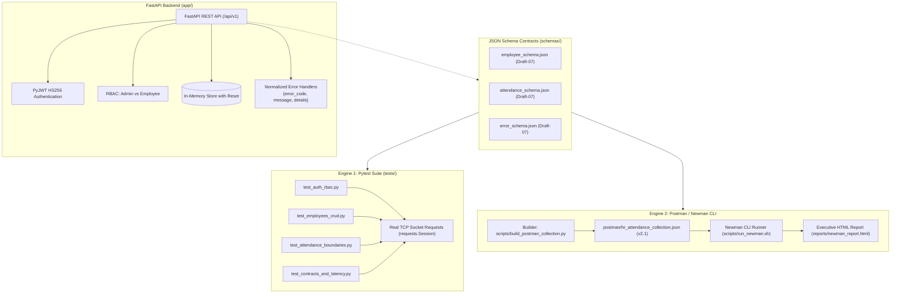

# HR & Attendance REST API — Automated QA Test Suite & Contract Validator

[](https://www.python.org/)
[](https://fastapi.tiangolo.com/)
[](https://docs.pytest.org/)
[](https://www.postman.com/)
[](https://learning.postman.com/docs/collections/using-newman-cli/command-line-integration-with-newman/)
[](https://json-schema.org/)

A production-grade, dual-engine QA test automation and schema contract validation platform built around a RESTful HR & Attendance backend.

---

## 📌 Executive Summary

In enterprise service architectures, APIs frequently suffer from **payload drift**, **undocumented breaking changes**, **unnormalized error responses**, and **unmonitored latency spikes**.

This portfolio project demonstrates an end-to-end Quality Assurance (QA) solution that validates a target REST API using two complementary, industry-standard paradigms:
1. **Code-First Automated Testing (Python / `pytest`)**: 92 automated tests asserting authentication lifecycles, role-based access control (RBAC), CRUD operations, negative input boundaries, and response time SLAs (< 300ms).
2. **Contract & CI/CD Runner Automation (Postman v2.1 / Newman CLI)**: Programmatically generated Postman test suite embedding Draft-07 schemas for automated contract validation with visual HTML executive reporting (`newman-reporter-htmlextra`).

---

## 🏛 System Architecture



---

## 🚀 Key Technical Highlights

### 1. Dual-Engine Test Harness
- **Pytest (92 Tests, 100% Pass Rate)**: Exercises every functional, negative, boundary, and latency permutation across the API.
- **Postman v2.1 Collection & Newman CLI**: 17 requests, 50 automated assertions, and variable chaining (`admin_token`, `employee_token`, `created_employee_id`) across 4 structured execution folders.

### 2. Strict Schema Contract Enforcement (Draft-07)
- Schemas strictly enforce `"additionalProperties": false`. If an endpoint leaks unexpected fields or changes property formats, validation fails instantly.
- Handled via `jsonschema.Draft7Validator` in Python and native AJV in Postman.

### 3. Real Socket Network Latency (<300ms SLA)
- Avoids in-process test client shortcuts. Tests execute real HTTP calls hitting `http://127.0.0.1:8000/api/v1` over loopback sockets.
- Every functional response is benchmarked:
  - **Pytest 20-Request Sequential Benchmark**:
    - **Min**: 1.25ms
    - **Average**: 2.03ms
    - **Max**: 3.45ms
    - **p95 Latency**: **3.45ms** (far below the 300ms threshold)
  - **Newman Suite Average**: **10ms**

### 4. Normalized Error Architecture
Every error response strictly returns a standard payload:
```json
{
  "error_code": "STRING_ERROR_CODE",
  "message": "Human-readable summary",
  "details": null | [ ... ] | { ... }
}
```
Validation failures (422), auth failures (401/403), resource misses (404), and duplicate conflicts (409) are normalized globally.

### 5. Idempotent Test Isolation
- Zero external database dependencies (runs anywhere deterministically).
- Includes an unauthenticated test utility endpoint (`POST /api/v1/test/reset`) that restores seed state (`EMP-1001`) before each test suite execution.

---

## 📂 Project Structure

```
├── app/                                   # Target FastAPI HR & Attendance Backend
│   ├── __init__.py
│   ├── auth.py                            # PyJWT HS256 auth, expired/tampered token helpers
│   ├── main.py                            # REST endpoints, in-memory store, error handlers
│   └── models.py                          # Pydantic v2 data models & boundary constraints
├── schemas/                               # Draft-07 JSON Schemas (additionalProperties: false)
│   ├── attendance_schema.json             # Attendance record response schema
│   ├── employee_schema.json               # Employee profile response schema
│   └── error_schema.json                  # Normalized standard error response schema
├── tests/                                 # Pytest Automated Test Suite (92 Tests)
│   ├── conftest.py                        # Server lifecycle fixture, tokens, schema validators
│   ├── test_attendance_boundaries.py      # Parametrized hours, ID regex, department, salary boundaries
│   ├── test_auth_rbac.py                  # Login 200, 401 token invalidation, exhaustive 403 RBAC matrix
│   ├── test_contracts_and_latency.py      # Negative schema contract tests, p95 latency benchmark
│   └── test_employees_crud.py             # Full employee lifecycle (POST->GET->PUT->DELETE->404)
├── postman/                               # Generated Postman v2.1 Artifacts
│   ├── hr_attendance_collection.json      # 17 requests, 50 assertions, 4 structured folders
│   └── local_env.json                     # Environment variables (tokens, IDs, base_url)
├── scripts/                               # Automation & Build Scripts
│   ├── build_postman_collection.py        # Programmatic builder compiling schemas into Postman
│   └── run_newman.sh                      # Headless runner exporting reports/newman_report.html
├── pytest.ini                             # Pytest config with markers (crud, auth, rbac, etc.)
├── requirements.txt                       # Python dependencies (FastAPI, PyJWT, Pytest, etc.)
└── package.json                           # Node.js devDependencies (newman, newman-reporter-htmlextra)
```

---

## 🧪 Test Suite Coverage & Verification

### Pytest Suite Breakdown

| Module | Test Categories | Assertions & Scenarios | Result |
|---|---|---|:---:|
| `test_auth_rbac.py` | Authentication & RBAC | Admin/Employee 200 logins, 401 missing/expired/tampered JWTs, complete 403 matrix across every endpoint | **18 Passed** |
| `test_employees_crud.py` | Full Lifecycle CRUD | `POST -> GET -> PUT -> DELETE -> GET 404`, 409 duplicate email conflicts, 404 non-existent resources | **6 Passed** |
| `test_attendance_boundaries.py` | Negative Boundaries | Work hours `< 0.5` & `> 16.0`, regex `^EMP-\d+$`, department enums, salary `$30k–$500k`, duplicate check-in 409 | **46 Passed** |
| `test_contracts_and_latency.py` | Contract & Latency SLA | Extra property rejection, missing key rejection, invalid types, 20-request sequential benchmark (p95: 3.45ms) | **22 Passed** |
| **Total** | | **All 4 Test Modules** | **92 Passed (100%)** |

### Newman CLI Runner Breakdown

| Folder | Request Name | Status Code | Latency | Schema Check |
|---|---|:---:|:---:|:---:|
| `00_Setup & Auth` | 01 - Reset In-Memory Store | 200 OK | < 300ms | Verified |
| `00_Setup & Auth` | 02 - Admin Login (saves `admin_token`) | 200 OK | < 300ms | Verified |
| `00_Setup & Auth` | 03 - Employee Login (saves `employee_token`) | 200 OK | < 300ms | Verified |
| `01_RBAC & Auth Negative` | 01 - Missing Token Rejection | 401 Unauthorized | < 300ms | Verified |
| `01_RBAC & Auth Negative` | 02 - Bad / Tampered Token Rejection | 401 Unauthorized | < 300ms | Verified |
| `01_RBAC & Auth Negative` | 03 - Employee Creating User Forbidden | 403 Forbidden | < 300ms | Verified |
| `01_RBAC & Auth Negative` | 04 - Employee Deleting User Forbidden | 403 Forbidden | < 300ms | Verified |
| `02_Employee CRUD` | 01 - Admin Create Employee (saves `created_employee_id`) | 201 Created | < 300ms | Verified |
| `02_Employee CRUD` | 02 - Admin Get Created Employee | 200 OK | < 300ms | Verified |
| `02_Employee CRUD` | 03 - Admin Update Created Employee | 200 OK | < 300ms | Verified |
| `02_Employee CRUD` | 04 - Admin Delete Created Employee | 204 No Content | < 300ms | Verified |
| `02_Employee CRUD` | 05 - Verify Deleted Employee 404 | 404 Not Found | < 300ms | Verified |
| `03_Attendance & Boundaries` | 01 - Valid Check-In as Employee | 201 Created | < 300ms | Verified |
| `03_Attendance & Boundaries` | 02 - Duplicate Check-In Conflict | 409 Conflict | < 300ms | Verified |
| `03_Attendance & Boundaries` | 03 - Negative Hours Validation Error | 422 Unprocessable | < 300ms | Verified |
| `03_Attendance & Boundaries` | 04 - Excessive Hours Validation Error | 422 Unprocessable | < 300ms | Verified |
| `03_Attendance & Boundaries` | 05 - Get Attendance List for Employee | 200 OK | < 300ms | Verified |
| **Total** | **17 Executed Requests** | **0 Failures** | **Avg: 10ms** | **50/50 Passed** |

---

## 🛠 Quickstart & Execution

### Prerequisites
- Python 3.11+
- Node.js 18+ (for Newman runner)

### 1. Installation
Clone the repository and set up the Python virtual environment:
```bash
git clone https://github.com/callbyIshant/hr-api-test-suite.git
cd hr-api-test-suite

python -m venv venv
# On Windows:
.\venv\Scripts\activate
# On Linux/macOS:
source venv/bin/activate

pip install -r requirements.txt
npm install
```

### 2. Run the Pytest Test Suite
The background server fixture in `tests/conftest.py` automatically detects or starts the live server:
```bash
pytest -v
```

Filter by marker:
```bash
pytest -m auth      # Authentication & JWT tests
pytest -m rbac      # RBAC permission matrix
pytest -m crud      # Employee CRUD lifecycle
pytest -m boundary  # Input boundary validations
pytest -m schema    # JSON schema contract tests
pytest -m latency   # Sub-300ms latency assertions
```

### 3. Rebuild the Postman Collection (Optional)
To regenerate the Postman collection and environment files from the schemas:
```bash
python scripts/build_postman_collection.py
```

### 4. Run the Newman CLI & HTML Report Runner
Execute the shell script to run Newman and export the visual report:
```bash
bash scripts/run_newman.sh
```
The report is generated at:
```
reports/newman_report.html
```
Open `reports/newman_report.html` in any browser to inspect full request/response payloads, timing breakdowns, and assertions.

---

## 👤 Author
- **Ishant Rustagi**
- GitHub: [@callbyIshant](https://github.com/callbyIshant)
